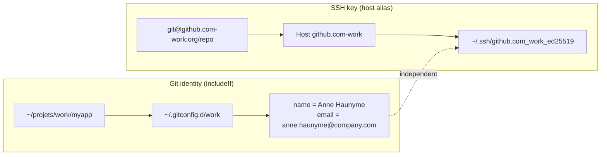
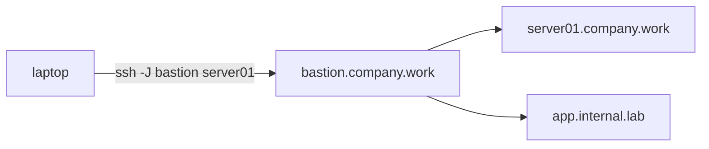
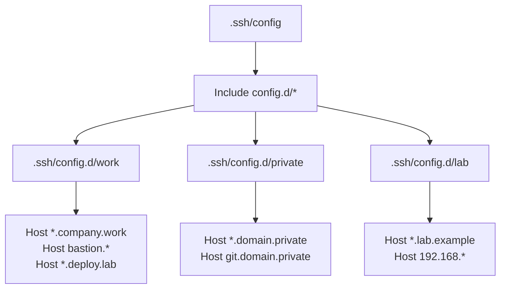

# SSH and Git identities

Reference for the SSH and Git identity templates shipped with MyFlec
(`.ssh/config`, `.ssh/config.d/`, `.gitconfig`, `.gitconfig.d/`). See also
[GIT-IDENTITY.md](GIT-IDENTITY.md) for the identity resolution order.

## Identity model

### Purpose

When you work with multiple git forges and identities (personal, work,
self-hosted), two things must align: who you commit as (Git name/email)
and which account pushes the code (SSH key). These two concerns are
orthogonal:

- **Git identity** (name/email): driven by the repository directory via
  `includeIf "gitdir:..."` in `.gitconfig`. One identity per project tree.
- **SSH key** (which account): driven by the SSH host alias used in the
  remote URL. One key per alias.

Keeping them separate means you can commit as your work identity while
pushing to a personal fork, or vice versa.

### Usage

#### Host aliases

The default block for each forge uses the personal key. Extra identities
use a host alias (`<forge>-<label>`). Clone with the alias to use a
different key:

```bash
# personal (default)
git clone git@github.com:owner/repo.git

# work identity
git clone git@github.com-work:owner/repo.git
```

#### Correspondence table

| Project directory | Git identity (includeIf) | SSH remote |
|---|---|---|
| `~/projets/github/` | personal GitHub | `git@github.com:owner/repo` |
| `~/projets/gitlab/` | personal GitLab | `git@gitlab.com:owner/repo` |
| `~/projets/work/` | work identity | `git@github.com-work:owner/repo` |
| `~/projets/company/` | company identity | `git@git.company.work:team/project` |

#### Architecture diagrams

**Two orthogonal axes: Git identity vs SSH key**



**ProxyJump / bastion**



**Include organization**



### Internals

- **includeIf gitdir:** in `.gitconfig` matches a directory prefix. When a
  repository is inside `~/projets/work/`, the matching `[user]` section
  overrides the default identity.
- **Host alias pattern**: `<forge>-<label>` in `.ssh/config` lets you specify
  a different `IdentityFile` while keeping the real `HostName`. The remote
  URL `git@github.com-work:owner/repo` routes through the `Host github.com-work`
  stanza.
- **Key naming**: `<forge>_<label>_<type>` (e.g.
  `github.com_perso_ed25519`, `company.work_companyuser_ed25519`).
- **IdentitiesOnly yes**: prevents SSH from trying other keys (e.g. default
  `~/.ssh/id_rsa`) when a host-specific key is configured.
- **First match wins**: SSH config reads top to bottom, includes expanded at
  their point of inclusion. Put specific host blocks before wildcards in
  config files.

## Advanced patterns

Beyond the basic forge identities, OpenSSH supports a rich set of patterns
for multi-environment access, bastion hosts, tunnels, and more. Each pattern
below follows the same structure: what it does and why you would use it, how
to use it, and how it is configured.

This section documents every pattern used in `.ssh/config.d/work`,
`.ssh/config.d/private`, and `.ssh/config.d/lab`.

### 1. Self-hosted forges

**Purpose**: reach an internal git server (GitLab CE, Gitea, Forgejo, etc.)
behind a VPN or bastion. Same `User git` pattern as public forges.

**Usage**:

```bash
git clone git@git.company.work:team/project.git
```

**Config** (`.ssh/config.d/work`):

```
Host git.company.work
    HostName git.company.work
    User git
    IdentityFile ~/.ssh/company.work_companyuser_ed25519
    IdentitiesOnly yes
```

Git identity is set via `includeIf` in `.gitconfig`:

```
[includeIf "gitdir:~/projets/company/"]
    path = ~/.gitconfig.d/company
```

### 2. Jump hosts / bastions

**Purpose**: reach internal services through a single hardened bastion host
without exposing internal hosts to the internet. SSH automatically opens a
connection to the bastion, then forwards to the target.

**Usage**:

```bash
ssh app.internal.lab
# connects through bastion transparently
```

**Config** (`.ssh/config.d/work`):

```
Host bastion.company.work
    HostName jump.company.work
    User companyuser
    IdentityFile ~/.ssh/company.work_companyuser_ed25519
    IdentitiesOnly yes
    ForwardAgent yes
    Compression yes

Host app.internal.lab
    HostName app.internal.lab
    ProxyJump bastion.company.work
```

### 3. Chained ProxyJump

**Purpose**: traverse multiple hops when no single bastion can reach the
target directly (e.g. laptop -> bastion -> swarm manager -> deploy target).

**Usage**:

```bash
ssh machine.deploy.lab
```

**Config** (`.ssh/config.d/work`):

```
Host *.deploy.lab
    User deploy
    IdentityFile ~/.ssh/company.work_deploy_ed25519
    IdentitiesOnly yes
    ProxyJump bastion.company.work,swarm-manager.deploy.lab
```

ProxyJump accepts a comma-separated list: connections are chained left to
right.

### 4. Connection multiplexing

**Purpose**: reuse a single TCP connection for multiple SSH sessions. The
first SSH connection establishes a control socket; subsequent connections to
the same host reuse it, skipping TCP handshake, DNS, and authentication.

**Usage**:

```bash
ssh server01.company.work   # slow (TCP + auth)
ssh server01.company.work   # instant (reuses control socket)
```

**Config** (all `config.d` files):

```
ControlPath ~/.ssh/cm-%r@%h:%p
ControlMaster auto
ControlPersist 10m
```

- `ControlMaster auto`: reuse an existing socket if available, otherwise
  create one.
- `ControlPersist 10m`: keep the background master connection alive for 10
  minutes after the last session closes (avoids reconnecting on rapid
  open/close cycles).
- `ControlPath`: names the socket file. `%r` = remote user, `%h` = host,
  `%p` = port.

### 5. Wildcard hosts

**Purpose**: apply common settings to a group of hosts without repeating
them for every hostname.

**Usage**: any host matching the pattern inherits the stanza settings.

**Config** (`.ssh/config.d/lab`):

```
Host *.lab.example
    User labuser
    IdentityFile ~/.ssh/lab.example_labuser_ed25519
    IdentitiesOnly yes
    ControlPath ~/.ssh/cm-%r@%h:%p
    ControlMaster auto
    ControlPersist 30m
    Compression yes
    ConnectTimeout 10
```

**Order matters**: SSH reads config top to bottom, first match per parameter
wins. Put specific host blocks before wildcards define broad defaults after
them.

### 6. Multiple keys (fallback)

**Purpose**: use ed25519 as the primary key (fast, modern) and fall back to
rsa4096 when the server only supports RSA. SSH tries each listed key in
order until the server accepts one.

**Usage**: SSH automatically selects the first accepted key.

**Config** (`.ssh/config.d/private`):

```
Host *.domain.private
    User privateuser
    IdentityFile ~/.ssh/domain.private_privateuser_ed25519
    IdentityFile ~/.ssh/domain.private_privateuser_rsa4096
    IdentitiesOnly yes
```

- `IdentityFile` can appear multiple times; keys are tried in list order.
- `IdentitiesOnly yes` prevents SSH from trying unlisted keys (e.g. the
  default `~/.ssh/id_rsa`).

### 7. SOCKS proxy (dynamic forward)

**Purpose**: tunnel all traffic through a bastion for privacy or
network access. SOCKS5 works with browsers, `curl`, git, and most network
tools.

**Usage**:

```bash
# Start the tunnel (background, no shell)
ssh -f -N -D 9050 bastion.company.work

# Use it
curl --socks5 localhost:9050 https://internal.example.com
git clone git@git.company.work:team/project.git
```

**Config** (dedicated host stanza in `.ssh/config`):

```
Host socks5
    HostName jump.company.work
    User companyuser
    IdentityFile ~/.ssh/company.work_companyuser_ed25519
    IdentitiesOnly yes
    DynamicForward 9050
    ExitOnForwardFailure yes
    ServerAliveInterval 30
```

Then start with: `ssh -f -N socks5`

- `-D 9050`: open a SOCKS5 proxy on `localhost:9050`.
- `-f`: fork to background after authentication.
- `-N`: do not execute a remote command (no shell).

### 8. Port forwarding (tunnels)

**Purpose**: expose a single remote port on your local machine. Useful for
accessing web dashboards, databases, or any TCP service behind a bastion
without a SOCKS proxy.

**Usage**:

```bash
# Forward remote port 443 to localhost:4443
ssh -f -N -o ServerAliveInterval=30 -o ExitOnForwardFailure=yes \
    -L 0.0.0.0:4443:app.internal.lab:443 bastion.company.work

# Access the service locally
curl https://localhost:4443
```

**Config** (`.ssh/config.d/work`):

```
Host tunnel-app
    HostName bastion.company.work
    User companyuser
    IdentityFile ~/.ssh/company.work_companyuser_ed25519
    IdentitiesOnly yes
    LocalForward 4443 app.internal.lab:443
    ExitOnForwardFailure yes
    ServerAliveInterval 30
```

Then start with: `ssh -f -N tunnel-app`

- `-L 0.0.0.0:4443:target:443`: listen on all interfaces (`0.0.0.0`) on
  port `4443`, forward connections to `target:443` through the bastion.
- `-f`: fork to background (no shell).
- `-N`: do not execute a remote command (pure tunnel).
- `-o ServerAliveInterval=30`: send keepalive every 30 seconds, drop stale
  tunnels.
- `-o ExitOnForwardFailure=yes`: exit immediately if the forward cannot be
  established (avoids silent failures).

**Related patterns**:

| Flag | Name | Use case |
|---|---|---|
| `-L` | Local forward | Expose a remote port locally |
| `-R` | Remote forward | Expose a local port on the remote host |
| `-D` | Dynamic forward | SOCKS5 proxy (see previous section) |

### 9. SSH over 443 (port 22 blocked)

#### Purpose

Some networks hard-block outbound port 22 (TCP fail, IPv4 and IPv6), which
kills `git push` to every public forge. GitHub and GitLab both publish
official SSH-over-443 endpoints, so the forges are routed through 443 by
default: it works everywhere and needs no manual switching.

#### Usage

`.ssh/config.d/forges` routes the forges. Verify the resolved config without
connecting, then test:

```bash
ssh -G github.com | grep -E 'hostname|port'
# hostname ssh.github.com
# port 443

ssh -T git@github.com
ssh -T git@gitlab.com
```

#### Internals

- `config.d/*` is included **before** the forge blocks in `~/.ssh/config`;
  SSH keeps the **first value seen** per option, so the 443 `HostName`/`Port`
  win while `User git` and `IdentityFile` still come from the main config.
- Endpoints and verified host fingerprints (checked against `known_hosts`
  before install):

  | Host | Endpoint | ED25519 fingerprint |
  |---|---|---|
  | github.com | `ssh.github.com:443` | `SHA256:+DiY3wvvV6TuJJhbpZisF/zLDA0zPMSvHdkr4UvCOqU` |
  | gitlab.com | `altssh.gitlab.com:443` | `SHA256:eUXGGm1YGsMAS7vkcx6JOJdOGHPem5gQp4taiCfCLB8` |

- `notabug.org` has no SSH-over-443 (443 is its web server only): it stays
  on port 22 and is reachable only from networks where port 22 passes. An
  HTTPS + Gitea token is the candidate fallback if needed.
